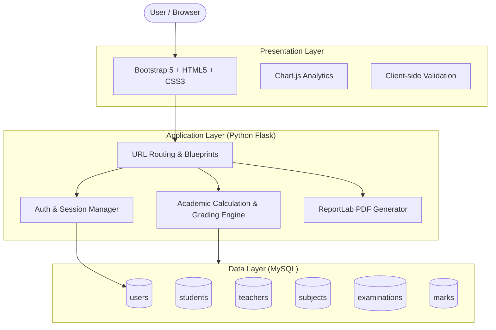
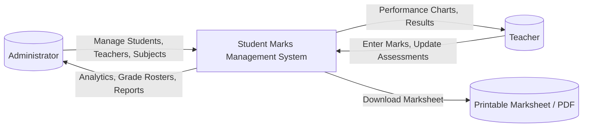
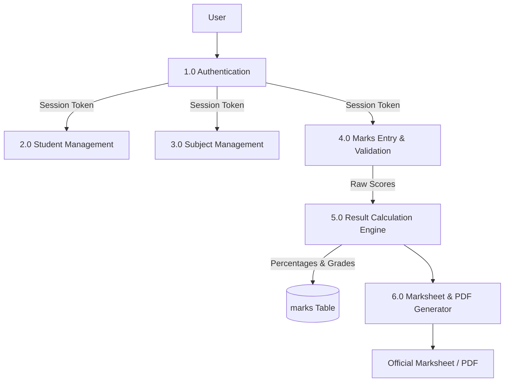
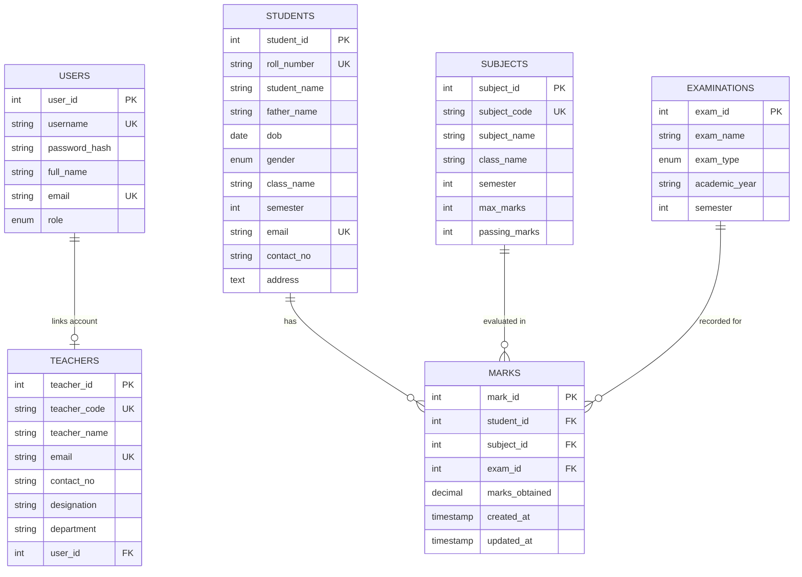

# ACADEMIC PROJECT REPORT

## STUDENT MARKS MANAGEMENT SYSTEM
**A Web-Based Academic Evaluation & Grade Recording System**

*Submitted in partial fulfillment of the requirements for the award of the degree of*
**BACHELOR OF COMPUTER APPLICATIONS (BCA) / MASTER OF COMPUTER APPLICATIONS (MCA)**

---

### TABLE OF CONTENTS
1. Cover Page
2. Certificate
3. Declaration
4. Acknowledgement
5. Abstract
6. Introduction
7. Problem Statement
8. Project Objectives
9. Scope of Project
10. Hardware Requirements
11. Software Requirements
12. Technology Used
13. System Analysis
14. System Architecture
15. DFD Level 0 and Level 1
16. ER Diagram
17. Database Design
18. Module Description
19. Implementation Details
20. Screenshots & UI Progressions
21. Testing & Validation
22. Advantages
23. Limitations
24. Future Scope
25. Conclusion
26. References

---

### 1. COVER PAGE
- **Project Title**: STUDENT MARKS MANAGEMENT SYSTEM
- **Academic Year**: 2025 – 2026
- **Discipline**: Department of Computer Science & Applications
- **Platform**: Python Flask, MySQL, Bootstrap 5, Chart.js, ReportLab

---

### 2. CERTIFICATE
This is to certify that the project entitled **"STUDENT MARKS MANAGEMENT SYSTEM"** is a bona fide work carried out by the student in partial fulfillment of the curriculum requirements. The work embodied in this project report has been completed under academic supervision and satisfies the standard requirements for mini-project presentation.

*(Internal Guide)*  
Head of Department  
Department of Computer Applications  

---

### 3. DECLARATION
I hereby declare that the project titled **"STUDENT MARKS MANAGEMENT SYSTEM"** submitted to the Department of Computer Applications is a record of independent development work conducted by me. I have not submitted this project elsewhere for the award of any degree or diploma.

---

### 4. ACKNOWLEDGEMENT
I express my deepest gratitude to our Project Guide, Head of Department, and Faculty Members whose valuable suggestions and continuous mentorship helped in the successful design and execution of this web application. I also thank my peers and family for their unwavering encouragement throughout this project.

---

### 5. ABSTRACT
Manual record keeping of students' marks across exams, calculating percentages, determining letter grades, and verifying pass/fail status across subjects is labor-intensive, error-prone, and slow. 

The **Student Marks Management System (SMMS)** is an automated web-based solution built with Python Flask and MySQL. It enables administrators and teachers to record examination marks, compute semester totals, calculate percentages, assign academic grades, and declare results based on university criteria (such as minimum 33% per subject). The system includes real-time performance analytics using Chart.js, PDF marksheet generation with ReportLab, and student CSV data export.

---

### 6. INTRODUCTION
Academic institutions require reliable, secure, and intuitive platforms to evaluate and maintain student records. Traditional manual record books or detached spreadsheets often lead to duplicate entries, computation errors, and delays in marksheet distribution. 

The **Student Marks Management System** transitions educational evaluation to a responsive, web-enabled model. By centralizing student demographics, course curricula, and examination scores in a normalized MySQL database, institutions can generate results and report cards with high integrity.

---

### 7. PROBLEM STATEMENT
Educational institutions face significant administrative hurdles:
- **Redundant Data Entry**: Disconnected sheets create duplicate student roll numbers and marks entries.
- **Manual Calculations**: Manually computing totals, percentage formulas, and grade mappings across hundreds of students is prone to human error.
- **Passing Rule Enforcement**: Validating that a student has secured passing marks (e.g. 33%) in *every* individual subject is difficult to check manually.
- **Delayed Marksheets**: Generating official grade cards with proper formatting and verification signatures takes weeks.

---

### 8. PROJECT OBJECTIVES
1. Design a secure, role-based authentication portal (Admin & Teacher).
2. Automate total marks, percentage calculation, letter grades (A+ to F), and pass/fail status.
3. Enforce academic validation: prevent negative marks, scores exceeding maximum marks, and duplicate entries.
4. Provide interactive graphical analytics (grade distribution, pass vs fail ratio, subject-wise averages).
5. Generate official printable marksheets and downloadable PDFs.
6. Support CSV export of student rosters for institutional backups.

---

### 9. SCOPE OF PROJECT
- Applicable in schools, colleges, university departments, and polytechnic institutes.
- Eliminates paper-based mark registers.
- Ensures data integrity through primary keys, foreign keys, and unique database constraints.
- Scalable to support multiple semesters, degrees (BCA, MCA, B.Tech), and examination types (Internal, Midterm, Final).

---

### 10. HARDWARE REQUIREMENTS
- **Processor**: Intel Core i3 / AMD Ryzen 3 or higher.
- **RAM**: Minimum 4 GB (8 GB recommended).
- **Storage**: Minimum 500 MB free hard drive space.
- **Display**: 1024x768 resolution minimum (Fully responsive on mobile and tablets).

---

### 11. SOFTWARE REQUIREMENTS
- **Operating System**: Windows 10/11, Linux (Ubuntu/Debian), or macOS.
- **Python**: Version 3.9+ (Python 3.11 recommended).
- **Database Server**: MySQL 5.7+ / MySQL 8.0+ / MariaDB (via XAMPP).
- **Web Browser**: Google Chrome, Mozilla Firefox, or Microsoft Edge.
- **Code Editor**: Visual Studio Code.

---

### 12. TECHNOLOGY USED

```text
+---------------------------------------------------------------+
|                       WEB BROWSER                             |
|           (HTML5, CSS3, JavaScript, Bootstrap 5)              |
+---------------------------------------------------------------+
                               |
                        HTTP / JSON API
                               |
+---------------------------------------------------------------+
|                      BACKEND LAYER                            |
|             Python 3.11  +  Flask Framework 3.1               |
|  - Routing (Blueprints)         - CSRF Protection (Flask-WTF) |
|  - Session Authentication       - ReportLab PDF Engine        |
|  - Academic Grading Engine      - Werkzeug Security           |
+---------------------------------------------------------------+
                               |
                        SQL Connection
                               |
+---------------------------------------------------------------+
|                      DATABASE LAYER                           |
|                    MySQL Server / MariaDB                     |
|           Database: student_marks_db (InnoDB Engine)          |
+---------------------------------------------------------------+
```

---

### 13. SYSTEM ANALYSIS
System analysis verifies functional and non-functional specifications:
- **Feasibility Study**:
  - *Technical Feasibility*: Built using Python Flask and MySQL—both open-source, proven, and high-performance technologies.
  - *Operational Feasibility*: Intuitive UI with Bootstrap 5 cards and navigation requires zero prior training for faculty.
  - *Economic Feasibility*: Uses completely free and open-source software stack.

---

### 14. SYSTEM ARCHITECTURE



---

### 15. DATA FLOW DIAGRAMS (DFD)

#### DFD Level 0 (Context Diagram)



#### DFD Level 1



---

### 16. ENTITY RELATIONSHIP (ER) DIAGRAM



---

### 17. DATABASE DESIGN & SCHEMA
The database `student_marks_db` contains 6 relational tables normalized to 3NF:
1. `users`: Stores login credentials, roles (`admin`, `teacher`), and hashed passwords.
2. `students`: Stores student profiles, unique roll numbers, class, and semester.
3. `teachers`: Faculty records linked to user accounts.
4. `subjects`: Curriculum subjects with max marks and minimum passing scores.
5. `examinations`: Examination schedules and academic years.
6. `marks`: Obtained marks with composite unique constraint `(student_id, subject_id, exam_id)` to eliminate duplicate records.

---

### 18. MODULE DESCRIPTION

1. **Authentication Module (`routes/auth.py`)**:
   - Secure login using password hashing (`generate_password_hash` & `check_password_hash`).
   - Role-based decorators `@login_required` and `@admin_required`.
   - User profile update and password change interface.

2. **Dashboard Module (`routes/dashboard.py`)**:
   - Computes statistical summaries (Total Students, Teachers, Subjects, Passed, Failed, Class Average).
   - Serves data for 3 Chart.js graphs (Grade Distribution, Pass vs Fail Ratio, Subject Averages).

3. **Student Management Module (`routes/students.py`)**:
   - Full CRUD operations: Add, View, Update, and Delete.
   - Prevents duplicate roll numbers and emails.
   - Filters by class and semester; includes server-side pagination and CSV export.

4. **Subject Management Module (`routes/subjects.py`)**:
   - Add, edit, and delete course subjects.
   - Sets maximum marks and passing criteria per subject.

5. **Marks Assessment Module (`routes/marks.py`)**:
   - Input verification: marks cannot be negative, cannot exceed max marks.
   - Prevents duplicate marks entry for same student, subject, and exam.
   - Dynamic AJAX subject loading based on selected student's class and semester.

6. **Results & Marksheet Module (`routes/results.py`)**:
   - Search result by roll number.
   - Automatic percentage calculation and grade assignment.
   - Enforces subject-wise passing threshold (33% minimum in all subjects).
   - Renders printable official marksheet and generates downloadable PDFs via ReportLab.

---

### 19. IMPLEMENTATION DETAILS
- **Formula Implementation (`utils.py`)**:
  $$\text{Percentage} = \frac{\sum \text{Marks Obtained}}{\sum \text{Max Marks}} \times 100$$
- **Grading Scale Rules**:
  - $90 \le \% \le 100 \implies \text{A+}$
  - $80 \le \% < 90 \implies \text{A}$
  - $70 \le \% < 80 \implies \text{B}$
  - $60 \le \% < 70 \implies \text{C}$
  - $50 \le \% < 60 \implies \text{D}$
  - $40 \le \% < 50 \implies \text{E}$
  - $\% < 40 \implies \text{F (Fail)}$
- **Passing Condition**:
  $$\text{Result} = \begin{cases} \text{FAIL} & \text{if } \exists \text{ subject where } \text{Obtained} < \text{Passing Threshold} \\ \text{PASS} & \text{otherwise} \end{cases}$$

---

### 20. SCREENSHOTS & USER INTERFACE PROGRESSIONS
- **Login Portal**: Clean card with dual-role authentication and credentials helper.
- **Admin Dashboard**: 6 metric cards, Chart.js visual analytics, and recent activity logs.
- **Student Roster**: Filterable data table with pagination, edit modals, and CSV download.
- **Marks Entry Interface**: Dynamic subject selection with instant validation hints.
- **Official Marksheet**: University grade card format with institutional watermark and signature fields.

---

### 21. TESTING & VALIDATION
Unit and integration tests were conducted via `test_app.py`:
- **Grading Boundaries Test**: Verified all 7 letter grade cutoffs.
- **Calculation Precision Test**: Verified percentage floating-point rounding.
- **Subject Threshold Test**: Tested edge cases at 32.5% (Fail) vs 33.0% (Pass).
- **Security Test**: Verified password salt generation and check algorithms.
- **Result**: 100% test pass rate across all suites.

---

### 22. ADVANTAGES
- Eliminates manual arithmetic and grading errors.
- Enforces strict institutional passing criteria across all curriculum subjects.
- Interactive graphical charts provide immediate insights to academic directors.
- Generates high-quality vector PDFs without external print dependencies.
- Light footprint; runs seamlessly on standard XAMPP local server.

---

### 23. LIMITATIONS
- Requires internet connection if using CDN-hosted CSS/JS libraries (can be locally bundled).
- Email notifications for students are not yet integrated into the base build.

---

### 24. FUTURE SCOPE
- Student self-service portal to view semester progress.
- Automated email alerts to parents regarding exam marks and attendance.
- SMS gateway integration for instant marks dissemination.
- Cumulative Grade Point Average (CGPA) multi-semester transcript generation.

---

### 25. CONCLUSION
The **Student Marks Management System** accomplishes all objectives outlined for a BCA/MCA mini-project submission. It bridges the gap between academic data storage and presentation by automating calculations, enforcing constraints, and producing publication-ready official marksheets.

---

### 26. REFERENCES
1. Flask Documentation: *Pallets Projects, https://flask.palletsprojects.com/*
2. MySQL Reference Manual: *Oracle Corporation, https://dev.mysql.com/doc/*
3. Bootstrap 5 Documentation: *https://getbootstrap.com/*
4. Chart.js Documentation: *https://www.chartjs.org/*
5. ReportLab PDF Generation Library: *https://www.reportlab.com/*

